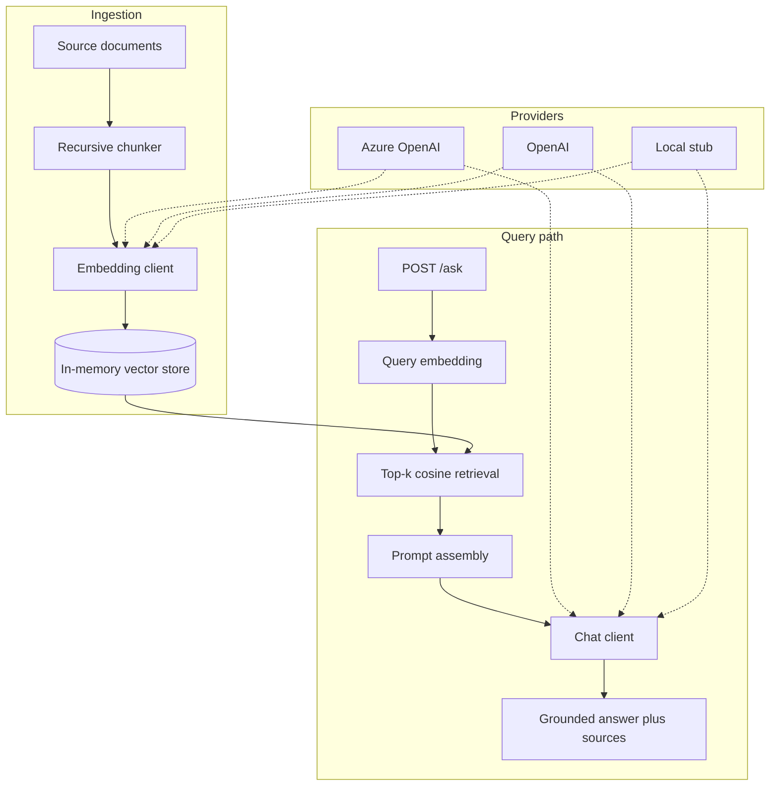

# enterprise-rag-azure

A small, runnable retrieval-augmented generation (RAG) reference implementation. It covers document chunking, embeddings, in-memory retrieval, prompt assembly, and a FastAPI query endpoint.

The embedding and chat clients are pluggable: **Azure OpenAI**, **OpenAI**, or a **local stub** so the pipeline and tests run fully offline. This is a teaching and interview-friendly skeleton, not a production service.

## Architecture



The provider is selected with `RAG_PROVIDER` (`stub`, `openai`, or `azure`). The rest of the pipeline stays the same.

## Quick start (offline)

```bash
python -m venv .venv
source .venv/bin/activate
pip install -r requirements.txt
cp .env.example .env   # defaults to RAG_PROVIDER=stub

# Ingest the sample policy document and ask a question from the CLI
python -m enterprise_rag --data data/sample_policy.md "What is the data retention period?"

# Or start the API
uvicorn enterprise_rag.api:app --app-dir src --port 8000
```

Example API calls:

```bash
curl -X POST http://127.0.0.1:8000/ingest \
  -H "Content-Type: application/json" \
  -d '{"documents":[{"id":"policy","text":"Retention is 7 years.","metadata":{"source":"policy.md"}}]}'

curl -X POST http://127.0.0.1:8000/ask \
  -H "Content-Type: application/json" \
  -d '{"query":"How long is data retained?","top_k":3}'
```

## Configuration

| Variable | Purpose |
| --- | --- |
| `RAG_PROVIDER` | `stub` (default), `openai`, or `azure` |
| `OPENAI_API_KEY` / `OPENAI_BASE_URL` | OpenAI-compatible chat and embeddings |
| `OPENAI_EMBEDDING_MODEL` / `OPENAI_CHAT_MODEL` | Model names for the OpenAI provider |
| `AZURE_OPENAI_API_KEY` / `AZURE_OPENAI_ENDPOINT` | Azure OpenAI resource |
| `AZURE_OPENAI_API_VERSION` | Azure REST API version |
| `AZURE_OPENAI_EMBEDDING_DEPLOYMENT` / `AZURE_OPENAI_CHAT_DEPLOYMENT` | Deployment names |

The local stub uses hashed bag-of-words embeddings and a deterministic extractive responder. It is intended for tests and demos, not for quality comparison with a hosted model.

## Project layout

```
src/enterprise_rag/   pipeline, clients, API
data/                 sample document used by the CLI
tests/                offline unit and API tests
```

## Tests

```bash
pip install -r requirements.txt
pytest -q
```

Tests always use the stub provider and do not make network calls.

## License

MIT © 2026 Rajesh Kumar Rajput
